# Island Progress Bar

**Your IDE's background tasks, in a themed pill at the top of your screen.**

<picture>
  <source media="(prefers-color-scheme: dark)" srcset="screenshots/hero-dark.gif">
  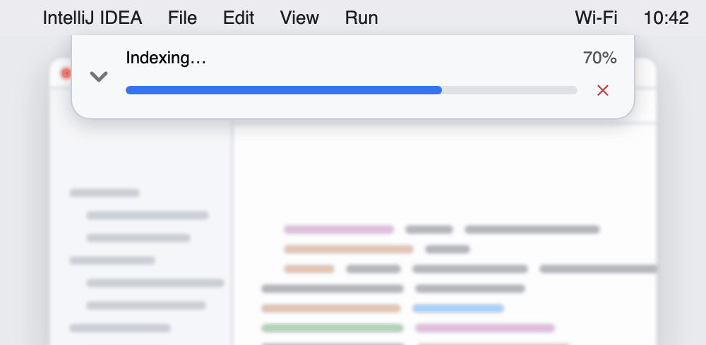
</picture>

This IntelliJ plugin puts the IDE's background work (indexing, Gradle syncs, builds, anything that shows progress in the status bar) in a floating pill at the top centre of your screen. Never look for the tiny bar in the corner of the IDE again!

- Follows your IDE theme (light, dark or third-party) and re-colours live.
- Three styles: **Menu bar**, **Floating** just below it (default), and **Ring**, a compact progress ring.
- One task in the pill, the rest in a dropdown, with **Cancel**, **Pause** (when the IDE allows it) and **Hide** for each.
- Long task names get a chevron that opens the list, where the full name wraps.
- Uses your progress bar theme, or the IDE's standard bar.
- Appears only for tasks that run longer than a tenth of a second; fades in and out, and respects macOS **Reduce Motion**.
- Hides the IDE's own inline progress bar while the pill is showing. Turn this off in [Settings](#settings).

## Install

Build the plugin with `./gradlew buildPlugin` (JDK 25). The zip is in `build/distributions/`. In the IDE: **Settings | Plugins | gear icon | Install Plugin from Disk...**, pick the zip, restart.

When upgrading, bump the version in `build.gradle.kts`: the IDE skips a same-version install.

## Requirements

- A Mac with Apple silicon. On other systems the plugin stays inert.
- IntelliJ IDEA 2026.1+ (or another JetBrains IDE on the same platform).

## Settings

**Settings | Tools | Island Progress Bar**

| Setting | Default | Range |
|---|---|---|
| Pill style, picked from live previews | Floating | Menu bar, Floating, Ring |
| Show after (ms): how long a task runs before the pill appears | 100 | 0–10,000 |
| Frame rate (fps): higher is smoother but uses more CPU | 30 | 10–60 |
| Hide the IDE's own progress bar while the pill is showing | On | On / Off |

On a Mac with a camera notch, the Menu bar style shows as Floating.

## Styles

| | Dark | Light |
|---|---|---|
| **Menu bar**: one line in the menu bar | 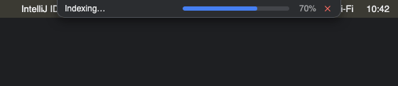 | 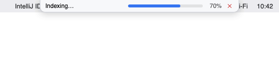 |
| **Floating**: below the menu bar | 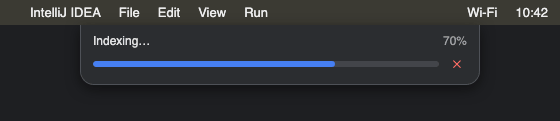 | 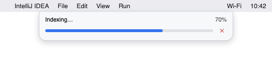 |
| **Ring**: progress ring | 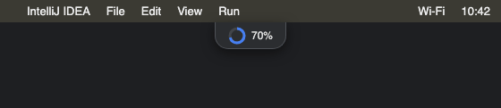 | 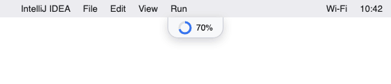 |
| **Task list**: Cancel, Pause, Hide per task | 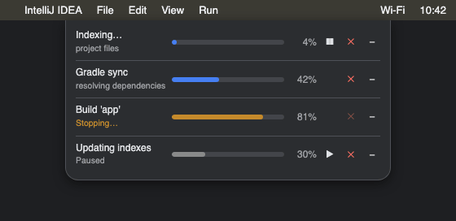 | 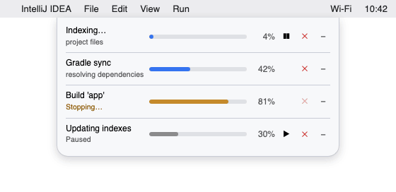 |
| **Several tasks** | 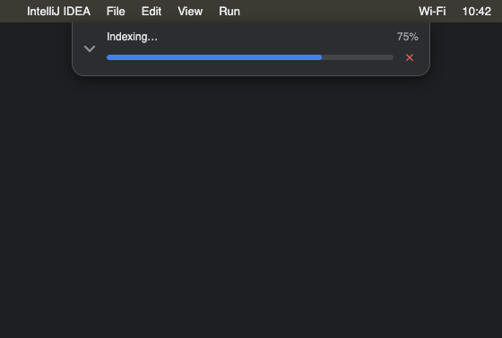 | 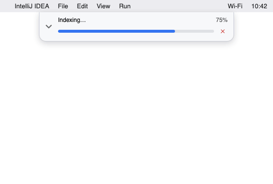 |

## Troubleshooting

If something fails, the plugin switches itself off until the IDE restarts and gives you back the IDE's own progress bar. It then writes the reason to the IDE log:

1. **Help | Show Log in Finder**, then open `idea.log`.
2. Search for `Island Progress Bar`. The line "disabled for this session" has the cause and a stack trace; "started" or "not supported here" show whether the plugin is active.

When reporting a problem, include those lines.

[Apache License 2.0](LICENSE)
